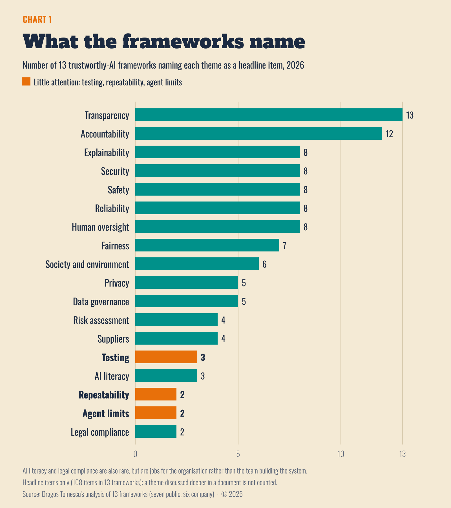
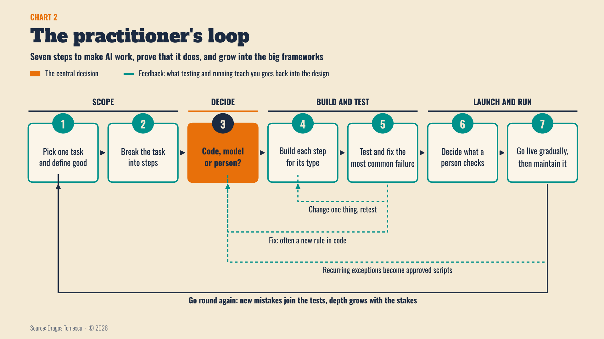
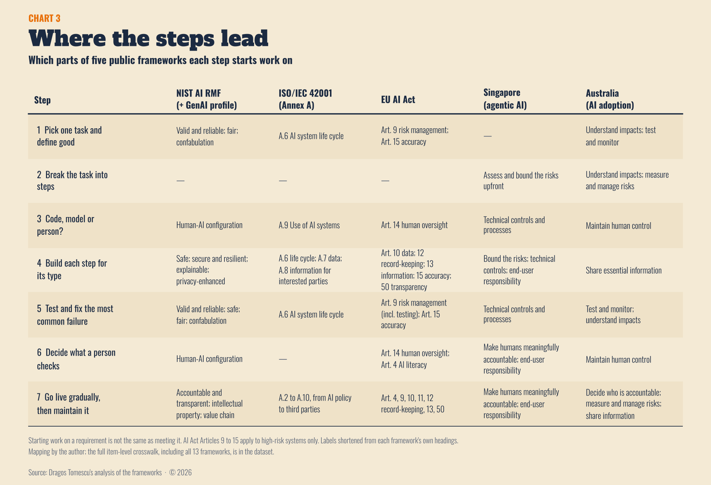

# Method and results: what 13 trustworthy-AI frameworks ask for

November 2026 · Dragos Tomescu

Frameworks for trustworthy AI ask for much the same things: transparency (13 of 13) and accountability (12 of 13) lead. Three things that are harder with today's AI get little attention at headline level: testing (3 of 13), repeatability (2) and limits on what AI agents may do (2, both written for agents). This file explains how those numbers were made and where they can mislead.

## The question

Frameworks for trustworthy AI are multiplying. What do they share, which parts are hardest for teams to apply, and what is the smallest set a team can start with and grow from? This dataset answers the first part. The article answers the rest.

## Which frameworks

Thirteen frameworks, chosen on 19 November 2026 by four rules: published by a government, a standards body, a major AI developer or a vendor or consultancy; explicitly covering generative AI or agents; current version in use; with dimensions a team could act on. Seven come from public bodies, six from companies. Security-only frameworks were left out (Google's SAIF), as were lists of principles with nothing to act on (Google's AI Principles). See `data/frameworks.csv`.

Two choices matter. For the EU, the unit is the AI Act's requirements (Articles 4, 9 to 15 and 50), not the code of practice for general-purpose models, which is written for model providers. Articles 9 to 15 bind high-risk systems only. Singapore appears twice (an agent framework and a testing framework from the same regulator); counting it once barely changes the results (`coverage.csv`, last column).

## What was coded

The unit is a headline item: each top-level principle, pillar, risk or practice a framework names with its own description. That gives 108 items. Sub-clauses are not separate items. NIST is coded from its seven trustworthiness characteristics and twelve generative-AI risks, not its four functions, which are structure, not content. ISO is coded from its Annex A control objectives.

Each item was tagged against a codebook of 19 themes (`codebook.csv`) under ten rules (`coding_rules.csv`). The codebook started with 17 themes, built from two earlier reviews of AI ethics guidelines (Jobin et al., 2019; Fjeld et al., 2020) plus themes expected to matter for generative AI and agents. Two were added during coding under rule 7 (three or more frameworks sharing a theme coded "Other"): supply chain and AI literacy.

Every code has a strength. Named means the item itself is about the theme; Mentioned means the theme appears only in its description. The article counts Named only.

## Who coded

1. **Claude** (Anthropic) coded every item first, with notes on each doubtful call.
2. **Gemini** (Google) coded every item again without seeing Claude's codes. It saw only the codebook and the items.
3. **The author** settled every disagreement, in 16 recorded decisions (`adjudication.csv`), and checked the item labels against the official texts where they were available.

A pilot on a subset of the frameworks (NIST, Australia and Alteryx) came first; the codebook was revised once (v1.1) before the full run.

## How far the coders agreed

| Measure | Result |
|---|---|
| Same primary theme | 101 of 108 items |
| Cohen's kappa, theme present or absent (108 items x 19 themes) | 0.89 |
| The same, excluding the 19 items used as codebook examples | 0.88 |
| Lowest kappa by theme | AI literacy 0.75, testing 0.76 |

The seven items with different primaries are F04-03, F04-04, F07-05, F07-07, F09-05, F10-04 and F12-03 (`agreement.csv`). Testing has a low kappa because "monitoring" falls between testing and human oversight.

This is agreement between two models, which may share blind spots. It is not evidence that people would code the same way.

## Results

How many of the 13 frameworks name each theme as a headline item (`coverage.csv`):

Transparency appears in all 13 and accountability in 12. Explainability, security, safety, reliability and human oversight appear in eight each, fairness in seven. Privacy has its own heading in five; four more fold it into data governance. Testing (3), repeatability (2) and agent action limits (2) are rare. AI literacy (3) and legal compliance (2) are also rare, but they are jobs for the organisation rather than the team building a system.

Process themes (risk assessment, testing, literacy, legal compliance) are named by public bodies only. That may partly reflect where companies put them: in the one company checked (KPMG), testing, training and legal compliance appear in a separate controls guide rather than the headline framework.

## The crosswalk

The article proposes a seven-step loop for teams building with AI:

`crosswalk_items.csv` records which steps start work on each of the 108 items, and how deep a team must go before the item is covered (stage 1 is a first, thin round; stages 2 and 3 are deeper rounds as the stakes rise). Of the 108 items, 89 are first addressed at stage 1, 12 at stage 2 and 2 at stage 3; 5 are not addressed by any step (all about society or the environment). Step 3 (code, model or person) has the thinnest backing in the frameworks.

Starting work on a requirement does not mean meeting it. Claude drafted the mapping and the author reviewed it; it was not coded twice.

## Limits

- **Headline items only.** A theme discussed below headline level does not count, so totals are lower than in reviews that code whole documents. This is the main reason not to compare these shares with the 2019 and 2020 reviews as a trend.
- **Small, chosen sample.** Thirteen frameworks, picked by rule but not at random.
- **Model coders.** See above.
- **ISO** was coded from secondary sources; the standard was not consulted.
- **Snapshot.** Versions as of November 2026.

## Changes

- 19 Nov 2026: corpus, codebook v1.1, coding and adjudication.
- 21 Nov 2026: crosswalk v0.4 (step names match the article; Singapore F04-03 added to step 3; AI Act Article 12 added to step 7).
